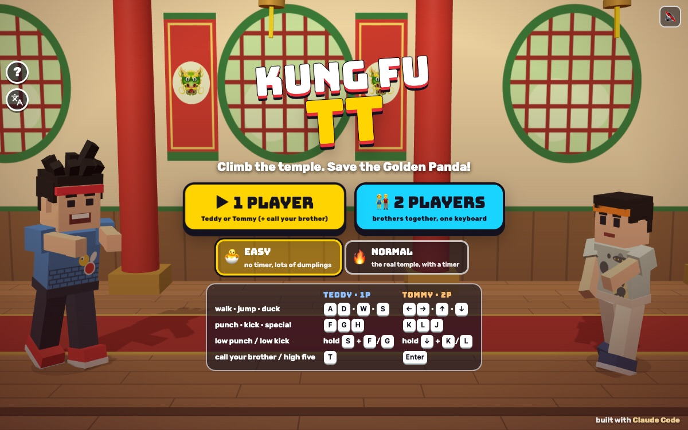

# Kung Fu TT

Press **?** any time (or tap the round **?** button on the left edge) to see the keys. The game waits while you look.
Tap the language button under it (the A文 icon) to switch between English and 中文; the dashboard and every game remember the choice.

**中文：** 功夫小子！Teddy 和 Tommy 一层一层打上五层寺庙，救出金熊猫。单人或双人。

A side-scrolling kung fu game starring Teddy and Tommy, in the spirit of the old one-lane arcade games where you fight floor by floor up a temple. Each floor is one long hall; floor 1 walks left, floor 2 walks right, and so on, with a boss waiting by the stairs. At the top, the Golden Panda waits in a bamboo cage.

It's silly, not violent. Hits make comic POW! and BONK! bursts, and a bonked baddie flies off spinning and poofs into stars. The huggers just want a hug. Nobody gets hurt.

It's built with Claude Code from plain JavaScript and Three.js r149, on the shared Claude Games kit. There are no image, model or audio files: the brothers and everyone else are the kit's blocky characters, every texture is painted on a canvas, and every sound is synthesised. The name lives in one place, `js/title.js`: the logo says "Kung Fu TT" in English and 功夫小子 in 中文.

## Play

- **Double-click `index.html`.** It works offline: Three.js and the kit are copied into `kit/`. Without internet the title font falls back to Arial Black.
- **Send one file:** `dist/kung-fu-tt.html` is the whole game inlined. AirDrop or email it, then open it in a browser.
- Rebuild that file after any edit: `python3 kit/tools/bundle.py . --name kung-fu-tt`

**1 PLAYER:** pick Teddy or Tommy. The other brother is one tap away (see *Companion* below).
**2 PLAYERS:** the brothers together on one keyboard, or side by side on one iPad.

Pick the difficulty on the title screen:

- **🐣 EASY** (the default), for Tommy (5):
  - no timer and 5 lives;
  - fewer baddies (at most 3 at a time) at about 60% speed, and their hits do half;
  - bosses have just over half their energy, wind up half again as long and hit for half;
  - a hug lets go after 3 presses (or by itself after 1.5 s), and can never take your last bit of energy;
  - dumplings 🥟 and buns 🍞 on every floor, and baddies often drop more;
  - shorter halls, and the specials recharge faster;
  - a **DUCK!** or **JUMP!** sign pops up over a bean-bag thrower before he throws.
- **🔥 NORMAL**, for Teddy (8): the classic pace, 3 lives and a relaxed timer of 180 seconds per floor.

When the timer runs out you lose a life and it starts again; the last life ends the game. **TRY AGAIN** replays that floor with full lives. Clear a floor and it shows up in the **FLOOR** row on the title screen, so you can start from any floor you've reached. The best score is kept.

## Moves

| Move | How | |
|---|---|---|
| High punch | punch | quick, hits grown-ups and hopping imps in the air |
| Low punch | duck + punch | hits the little ones on the floor |
| High kick | kick | reaches further than a punch |
| Low kick | duck + kick | a sweep along the floor: imps, paper dragons, confetti balls |
| Duck | down | ducks under high bean bags, staff pokes and the Grand Master's palm |
| Jump | up | jumps over low bean bags, sweeps and the Giant's stomp waves |
| Flying kick | jump, then kick | the strongest normal hit (a punch in the air works too) |
| **Teddy's special** 🥊 | special | his boxing combo, jab, jab, STRAIGHT!, that hits high and low and knocks back hard |
| **Tommy's special** ✌️ | special | his Y pose: a peace wave all round him that stuns grown-ups, bonks the little ones and swats things in the air |

- Each special has a cooldown (Teddy 5 s, Tommy 6 s on NORMAL; quicker on EASY). The round icon on your card fills up, and the touch button glows when it's ready. You can't be hit during a special.
- Bean bags and the magician's sparkles can be punched or kicked away (BOP!).

**The baddies** (all kid-friendly, all our own):

- **Huggers:** fuzzy bear-hooded friends who walk up and hug you. A hug slowly drains your energy until you wiggle free: press any key at all, or tap anywhere on the screen, a few times fast (3 on EASY, 6 on NORMAL). A big WIGGLE FREE! sign shows while you're held, and a hug never lasts long: the huggers get tired and let go after 1.5 s on EASY, 3 s on NORMAL.
- **Bean-bag throwers:** keep their distance and throw high (duck) or low (jump). They wind up first so you can see which.
- **Hopping imps:** tiny horned bouncers. Low attacks hit them on the floor, high kicks hit them in the air.
- **Pots:** hang from the beams, wobble, and drop just ahead of you (stop, or kick them as they fall). Out jumps a silly **paper dragon** that wiggles along the floor, or a **confetti ball** that rolls up and goes POP!

Score: hugger 100, thrower 200, imp 300, dragon or confetti ball 150, a bopped bean bag 50, a kicked pot 100, a boss 2,000 × the floor, and at the end of each floor a bonus for the energy left (and the time left, on NORMAL).

## Floors and bosses

Every boss has an energy bar, a pattern to learn and a wind-up before each move, with a **DUCK!**, **JUMP!** or **BACK!** sign over his head. He shrugs off hits while winding up and swinging, and hops away after three quick hits, then attacks. Beaten, he bows ("you win!") and poofs, and the brothers celebrate with their signature moves: Teddy's boxing and jump shot, Tommy's ✌️ Y.

| Floor | Hall | Boss | Pattern |
|---|---|---|---|
| 1 | 🎋 Bamboo Hall | **Staff Master** | walks up and pokes high (duck) or sweeps low (jump); every third move a low spin (jump) |
| 2 | 🏮 Lantern Hall | **Boomerang Bao** | keeps his distance and throws a boomerang high or low; dodge it on the way out *and* back. Too close and he belly-shoves you (step back), then hops away |
| 3 | 🥁 Drum Hall | **Big Belly Giant** | stomps, sending a wave along the floor both ways (jump it); close up, a big belly bump (step back). He hardly flinches |
| 4 | ☁️ Cloud Hall | **Puff Magician** | throws sparkles high or low, vanishes in a puff, and splits into copies. The real one's hat star twinkles; a copy poofs at one touch |
| 5 | 🐼 Golden Hall | **Grand Master** | a palm wave (duck), a flying kick across the room (duck), a sweep (jump) and quick high or low strikes |

After the Grand Master, the bamboo cage opens and the Golden Panda cheers, with confetti, then **PLAY AGAIN**.

## Controls

| | Teddy (player 1) | Tommy (player 2) | Touch |
|---|---|---|---|
| walk (→ is always right on screen, whichever way the floor goes) | A D | ← → | d-pad ◀ ▶ |
| jump · duck | W · S | ↑ · ↓ | d-pad ⬆ JUMP · ⬇ DUCK |
| punch | F | K | 👊 PUNCH |
| kick | G | L | 🦶 KICK |
| special | H | J | 🥊 / ✌️ SPECIAL |
| call your brother (1P) · high five (2P) | T | Enter | tap his face (1P) or HIGH FIVE! (2P) |

- In 1 player both key sets drive you, and Space jumps too.
- **P** or Esc pauses and **M** turns the sound on or off. The ❚❚ and 🔊 buttons at the top do the same, and the sound switch is shared with every game.
- **Menus:** on the title, Enter starts 1 player and 2 starts 2 players; ← → switch EASY / NORMAL; ↑ ↓ pick a floor you've reached. On *Who's playing?*, ← → and Enter. Esc goes back.
- **Touch:** the d-pad and buttons appear on the first touch (or add `?touch=1` to the address). For a low punch or kick, hold ⬇ DUCK with one thumb and press 👊 or 🦶 with the other. In 2 players Teddy's controls are on the left and Tommy's on the right, so two kids can share one iPad. The kit's round ?, A文 and speaker buttons sit on the left edge under the player card, well above the d-pad.
- A knocked-out brother sits down dizzy. In 1 player he gets up with full energy and one life fewer. In 2 players the other brother walks over and stands next to him to help him up (no life lost); if nobody comes, he gets up on his own after 8 seconds; if both are down, it costs a life and both get up.

## Companion

- **1 player:** press **T** (or Enter), or tap your brother's big face in the top right, any time and as often as you like.
  - He flies in at his buddy size with a flying kick that bonks every baddie on screen (a boss only takes a little), and frees you from any hugs.
  - He lands and does his signature move: Teddy's boxing, Tommy's ✌️ Y.
  - He tosses you a treat that refills some energy (🍦 💧 🧃 🍪 🍉 🍌 🥟), with a toast like "TOMMY SAYS: HI-YAH!", then waves and leaps away.
  - Calling again while he's there sends him into another flying kick and another treat.
- **2 players:** T (or Enter, or the HIGH FIVE! button) is a high five: both brothers hop up with a hand raised (HIGH FIVE!), and for 6 seconds they're powered up (double damage, specials ready and recharging fast). It's ready again 8 seconds later.

## How it's built and tested

- `js/sim.js` is the rules, pure logic at a fixed 1/60 s step with no Three.js, so it runs in node too. `js/bot.js` is an autopilot that plays with the same inputs a kid has. `js/checks.js` holds the checks; `js/game.js` draws what the rules say.
- `node tools/check.js --prove` (about a second) and `game.check()` / `game.prove()` in the page run the same 121 checks, at the game's real view widths (4.6 m either side on a wide screen, 4.0 on an iPad, 3.2 on a portrait phone):
  - the autopilot clears all 5 floors on EASY and floors 1–2 on NORMAL, as Teddy, as Tommy, as Tommy calling his brother, and in 2 players, with two seeds each;
  - no baddie, pot creature or magician's copy ever appears on top of a brother;
  - every hug is escaped by mashing at 4 presses a second (one or two huggers, both levels), and by doing nothing (the hugger gets tired);
  - every boss fight ends, both against the autopilot and against an idle player;
  - the timer runs out, costs a life and refills, and the last life ends the game; EASY has no timer;
  - knock-outs cost a life and get you up with full energy; 2-player revive works, and nobody gets up without his brother;
  - the companion bonks everyone on screen, a boss only loses a little, the treat heals, and you can call him again and again; the 2-player high five powers up both.
  - `--prove` runs broken versions (an idle player, a baddie spawned on top of a brother, a hug you can't escape, a timer that never runs) and passes only if every one is caught.
- **Play checks with real key events:** `game.playCheck()` in the page (js/playcheck.js, a few seconds) presses keys the way a kid does, with `keydown` / `keyup` on the window and pointer events on the d-pad and the screen:
  - on every floor, → (and D) walks right on screen and ← (and A) left, in 1 and 2 players and on the touch d-pad; he faces that way, a punch and a low kick land on whoever stands there, and the GO arrow points the way the floor goes;
  - a hug always ends: doing nothing (1.5 s on EASY), mashing keys the game doesn't even use, mashing ← →, or tapping the screen, with one or two huggers, and the WIGGLE FREE! sign shows while you're held;
  - in 2 players a knocked-out brother nobody helps gets up by himself; nothing from the title screen stays in the hall;
  - a "keyboard kid" (the autopilot's choices turned into screen-side key presses, plus random key bashing) plays 10 floors on EASY and NORMAL, 1 and 2 players: no error, nobody stuck in a hug, a stagger or a crouch, and every floor finished. `KF_PLAYCHECK.softlock({ seed })` runs it with another seed; each run replays exactly.
  - These checks were run against the first version first, and failed there: 16 of 32 direction checks (floors 1, 3 and 5 were mirrored), 10 of 12 hug checks, the 2-player knock-out (stayed down for ever), the title ghosts (9 figures in the hall for one brother) and the keyboard kid on floor 1 (walked backwards, never got anywhere).
- In the page: `game.start({ floor, mode, hero, difficulty, seed })`, `game.step(seconds)`, `game.autoplay(true)`, `game.warp()` (to the boss), `game.state()`, `game.show(screen)`, `game.quiet()`.

## Not verified

- Sound by ear: every test ran muted, and the sounds were only checked in code.
- Real fingers on an iPad or a phone, and iOS Safari. The touch layouts were checked in a desktop browser at phone portrait (390×844), phone landscape (740×360) and iPad (1024×768) sizes, with synthetic taps.
- A real double-click: the page booted from `file://` in headless Chrome (that's the screenshot above), but nobody opened it by hand from Finder.
- Real kids: the EASY and NORMAL balance is tuned against the autopilot, which is a better fighter than a 5-year-old.
